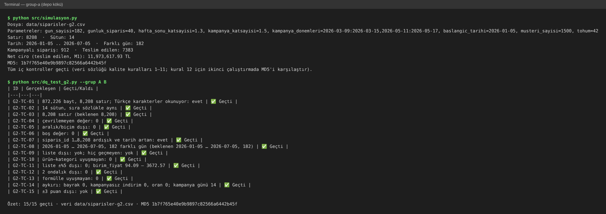
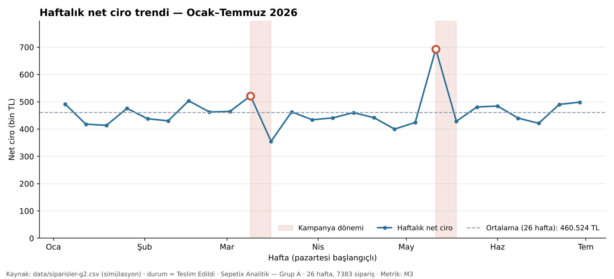
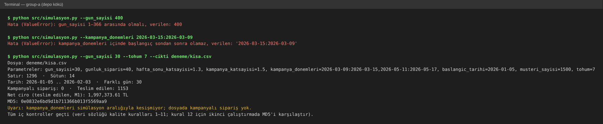

# Kullanım Kılavuzu — Sepetix Analitik Mini Ürün (Görev 2)

> **Durum:** Görev 2 sürümü (Hafta 6, #64) — `main` @ `ffb363e` (PR #72, #75, #79 merge sonrası). Kurulum + 4 kullanım senaryosu.
> Ürünün amacı ve kapsamı: `docs/requirements.md` · Alanlar, parametreler, kurallar: `docs/veri-sozlugu.md`

## 1. Ürün ne yapar?

Sentetik e-ticaret sipariş verisi üretir (`src/simulasyon.py`), veriyi veri sözlüğüne göre sınar (`src/dq_test_g2.py`), metrikleri hesaplar (`src/dq_analiz_g2.py`) ve grafikleri çizer (`src/fe_gorsel.py`). Gerçek kişisel veri kullanılmaz; aynı parametre ve tohumla her çalıştırma birebir aynı dosyayı verir.

## 2. Kurulum

**Gerekenler:** Python 3.10 veya üstü (3.13 ile denendi), `pandas`, `numpy`, `matplotlib`, Git.

```bash
git clone https://github.com/MAKU-VBA-GBT-II/group-a.git
cd group-a
python -m pip install -r requirements.txt   # pandas, matplotlib
```

Kurulumu doğrulamak için:

```bash
python --version                  # Python 3.10+
python src/simulasyon.py --help   # parametre listesi görünmeli
```

> Tüm komutlar **depo kökünde** (`group-a/`) çalıştırılır; betikler `data/`, `docs/` gibi yolları buna göre arar.
> Windows'ta `python` yerine `py` gerekebilir.

## 3. Senaryo 1 — Veriyi üret ve kalitesini kontrol et

**Amaç:** varsayılan parametrelerle 26 haftalık sipariş dosyasını üretmek ve veri sözlüğündeki kurallara uyduğunu görmek.

**Adım 1 — Veriyi üret**

```bash
python src/simulasyon.py
```

Betik `data/siparisler-g2.csv` dosyasını yazar ve bir özet basar: kullanılan parametreler, satır/sütun sayısı, tarih aralığı, net ciro ve dosyanın MD5 özeti.

**Adım 2 — Kalite testlerini koş**

```bash
python src/dq_test_g2.py --grup A B
```

A ve B grupları (G2-TC-01…15) dosyanın yapısını ve içeriğini sınar: sütunlar, satır sayısı, tipler, aralıklar, boş değer, tarih sırası, ürün–kategori eşleşmesi, fiyat ve formüller.

**Beklenen sonuç**



*Şekil 1 — Senaryo 1, `main` (`fe41763`) üzerinde, 2026-11-01.*

| Kontrol | Beklenen değer |
|---|---|
| Satır · Sütun | 8208 · 14 |
| Tarih aralığı | 2026-01-05 … 2026-07-05 (182 gün) |
| Net ciro (M1) | 11.973.617,93 TL |
| MD5 | `1b7f765e40e9b9897c82566a6442b45f` |
| Test özeti | `15/15 geçti`, çıkış kodu 0 |

MD5 aynıysa dosya depodaki sürümle birebir aynıdır (veri sözlüğü kural 12: tekrar üretilebilirlik).

**Sık karşılaşılan durumlar**

- `ModuleNotFoundError: No module named 'pandas'` → Kurulum adımındaki `pip install -r requirements.txt` komutunu çalıştırın.
- `FileNotFoundError: data/siparisler-g2.csv` → Komutu depo kökünde çalıştırdığınızdan emin olun.
- Test özeti `x/15` ve bazı satırlar `❌ Kaldı` → Kalan senaryonun "Gerçekleşen" sütunu sorunu söyler; `tests/test-cases.md`'deki aynı ID'ye bakın ve bir bug Issue'su açın.
- A/B testleri **varsayılan** parametrelerle üretilmiş dosyayı bekler (ör. satır sayısı 8.208). Farklı parametreyle ürettiğiniz dosyada `--dosya` ile koşarsanız G2-TC-03, 08 ve 15 kalabilir; bu bir hata değildir.

## 4. Senaryo 2 — Metrikleri hesapla

**Amaç:** veri sözlüğündeki metrikleri (M1–M6) hesaplamak.

```bash
python src/dq_analiz_g2.py                       # metrik tabloları ekrana
python src/dq_analiz_g2.py --ek                  # yorumlar için ek istatistikler
python src/dq_analiz_g2.py --cikti sonuc.md      # aynı çıktıyı dosyaya da yazar
```

**Beklenen sonuç (varsayılan veri):**

| Metrik | Değer |
|---|---|
| M1 toplam net ciro | 11.973.617,93 TL |
| M2 ortalama / medyan sepet | 1.621,78 TL / 728,95 TL |
| M3 haftalık ortalama | 460.523,77 TL (26 hafta; en yüksek 2026-05-11 haftası) |
| M4 kanal payı | Web %44,3 · Mobil %41,4 · Pazaryeri %14,3 |
| M5 ilk 5 ürünün payı | %58,9 |
| M6 iade + iptal | %10,1 |

Sayıların yorumu, 3 bulgu ve eylem önerisi: `docs/analiz-g2.md`. Para metrikleri yalnızca `durum == "Teslim Edildi"` siparişlerden hesaplanır.

## 5. Senaryo 3 — Grafikleri üret

**Amaç:** üç grafiği `visuals/` klasörüne yazmak.

```bash
python src/fe_gorsel.py
```

Konsolda üç satır `Yazıldı: visuals/….png` görünür:

| Dosya | Ne gösterir |
|---|---|
| `visuals/haftalik-net-ciro.png` | M3 — haftalık net ciro, ortalama çizgisi, kampanya haftaları bantlı |
| `visuals/kanal-ciro-payi.png` | M4 — kanal bazlı net ciro ve pay |
| `visuals/siparis-tutari-dagilimi.png` | Sipariş tutarı dağılımı, M2 ve medyan çizgisi; 7.000 TL üstü ayrı kovada |



*Şekil 2 — Senaryo 3 çıktısı: kampanya haftaları (9–15 Mart, 11–17 Mayıs) bantlı, ortalama 460.524 TL.*

Başka bir veri dosyasının grafiklerini ayrı bir klasöre üretmek için: `python src/fe_gorsel.py deneme/kisa.csv --klasor deneme/grafikler`. Kampanya bantları ve başlıktaki tarih aralığı veriden okunur, dosyaya göre değişir.

## 6. Senaryo 4 — Kendi parametrelerinle veri üret

**Amaç:** farklı bir dönem veya hacimle veri üretmek ve hatalı girişte ne olduğunu görmek.

```bash
python src/simulasyon.py --gun_sayisi 30 --tohum 7 --cikti deneme/kisa.csv
```

> `--cikti` vermezseniz betik `data/siparisler-g2.csv`'nin **üstüne yazar**. Deneme dosyalarını başka bir klasöre yazın ve commit'lemeyin.



*Şekil 3 — Senaryo 4: aralık dışı değer ve ters kampanya aralığı reddedilir; geçerli parametrelerle dosya yazılır.*

| Ne gördünüz? | Anlamı |
|---|---|
| `Hata (ValueError): gun_sayisi 1–366 arasında olmalı, verilen: 400` | Değer izinli aralığın dışında; dosya yazılmadı (çıkış kodu 1). Bölüm 7'deki aralıklara bakın. |
| `… başlangıç sondan sonra olamaz` | Kampanya dönemi `BAŞ:SON` sırasıyla yazılmalı. |
| `Uyarı: kampanya_donemleri simülasyon aralığıyla kesişmiyor` | Hata değil; dosya yazıldı ama seçtiğiniz tarihlerde kampanya yok. Kampanya istiyorsanız dönemi simülasyon aralığına çekin. |
| `Tüm iç kontroller geçti` | Dosya veri sözlüğünün kalite kurallarına uyuyor. |

Aynı parametre ve tohumla ikinci çalıştırmada MD5 aynı çıkar (tekrar üretilebilirlik).

## 7. Parametreler (özet)

| Parametre | Varsayılan | Örnek |
|---|---|---|
| `--gun_sayisi` | 182 | `--gun_sayisi 10` → 424 satır |
| `--gunluk_siparis` | 40 | hafta içi günlük sipariş |
| `--hafta_sonu_katsayisi` | 1.3 | hafta sonu çarpanı |
| `--kampanya_katsayisi` | 1.5 | kampanya haftası çarpanı |
| `--kampanya_donemleri` | `2026-03-09:2026-03-15,2026-05-11:2026-05-17` | `BAŞ:SON` biçiminde, virgülle ayrılır |
| `--baslangic_tarihi` | 2026-01-05 | `YYYY-AA-GG` |
| `--musteri_sayisi` | 1500 | müşteri havuzu |
| `--tohum` | 42 | farklı tohum → farklı ama geçerli dosya |
| `--cikti` | `data/siparisler-g2.csv` | başka dosyaya yazmak için |

İzinli aralıklar ve satır sayısı formülü: `docs/veri-sozlugu.md` → Parametreler. Aralık dışı veya biçimi bozuk bir değer verilirse betik dosya yazmadan durur ve `Hata (ValueError): …` mesajı verir (bkz. Senaryo 4).

---
Üretim: dq-test skill'i ile, Claude — prompt özeti: "Merge edilmiş ürün üzerinde test turunu koş, sonuçları tests/test-log.md'ye tarihli yaz, docs/user-manual.md'ye kurulum ve ekran görüntülü 1 senaryo ile başla." · Güncelleme: "PR #72, #75, #79 merge edildi; kılavuza analiz, grafik ve kendi parametrelerinle veri üretme senaryolarını ekle, komutları main'de çalıştırıp çıktıları doğrula."
